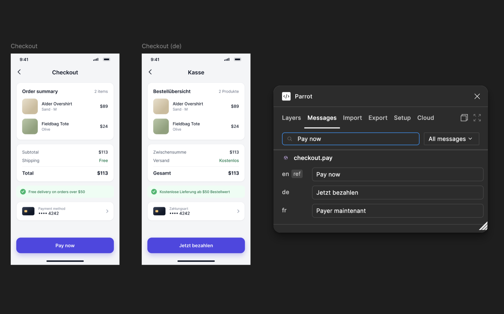
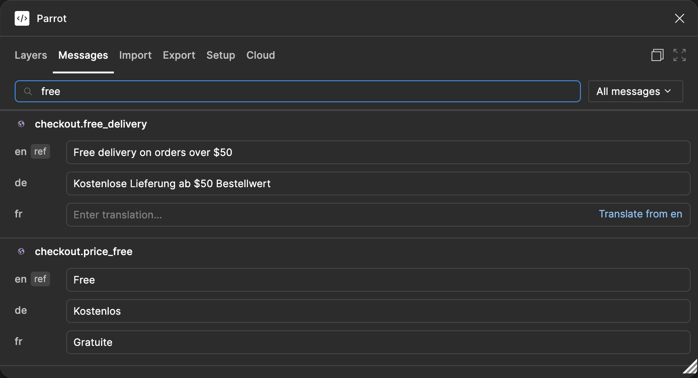
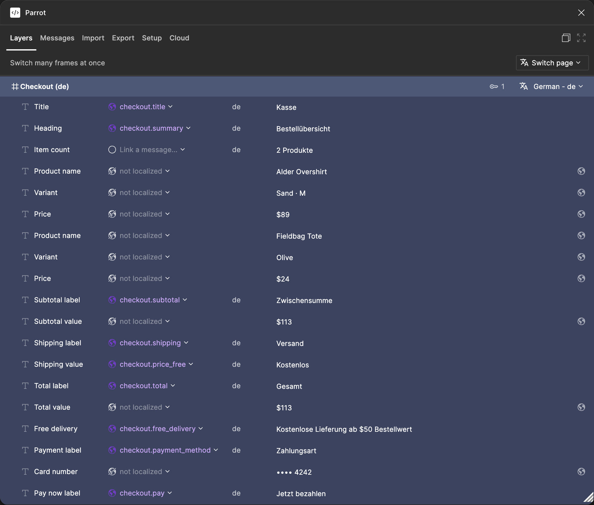

### Parrot

Localize your Figma designs. Link text layers to messages, switch whole frames between languages, and import and export translations in the formats your app already uses.

[**Install from the Figma Community**](https://www.figma.com/community/plugin/1205803482754362456) &nbsp;&bull;&nbsp; [inlang](https://inlang.com) &nbsp;&bull;&nbsp; [Issues](https://github.com/opral/parrot-figma/issues) &nbsp;&bull;&nbsp; [Discord](https://discord.gg/gdMPPWy57R)

  

## Install

Install [Parrot from the Figma Community](https://www.figma.com/community/plugin/1205803482754362456), then run it from **Plugins** in any Figma Design file. In Dev Mode, Parrot shows a read-only panel with the message of the selected layer.

## Start with one frame

1. Open Parrot and set your reference language and target languages in **Setup**.
2. Select a frame and choose **Generate keys**, or link text layers to existing messages in **Layers**.
3. Write or import the translations in **Messages**, then switch the frame to another language.

Your messages live in the Figma file, so everyone who opens the file sees the same translations.

## Translate in Figma

- **Link text to messages.** Link a layer to a message, or let Parrot generate keys for every text layer in a frame and link layers that already show the same text.
- **Switch languages.** Switch one frame, many frames or a whole page between languages. Bold, lists and line breaks stay as designed.
- **Plurals and selects.** Edit every language of a message side by side, including plural forms, selects and exact numbers. A layer linked to a plural shows the form of its own count, which you set under the layer's text in **Layers**.
- **Checks.** Parrot flags missing and empty translations, missing or unknown variables, and missing plural forms before developers see them.

See the Messages and Layers tabs

### Messages

All languages of a message in one place, with checks under each translation.

### Layers

See which layers in a frame are linked, and switch the frame to another language.

## Import and export

Parrot reads and writes the formats of your codebase, so translators work in Figma and developers get files they can use.

| Format | Used by |
| --- | --- |
| Inlang JSON | inlang apps |
| i18next JSON | i18next, react-i18next |
| ICU MessageFormat | FormatJS, react-intl and others |
| Inlang Message Format | Paraglide JS |
| next-intl JSON | next-intl |
| Android XML | Android apps |
| Apple strings and String Catalogs | iOS and macOS apps |

Open the **Import** tab, choose a format, review the preview and import. Imports never write to your file before you confirm.

## Machine translation

Machine translation is not built in. Request access to inlang Cloud from the **Cloud** tab.

## Contributing

Parrot is open source and built on the [Inlang SDK](https://inlang.com). Issues and pull requests are welcome. See [Developing Parrot](docs/development.md).
